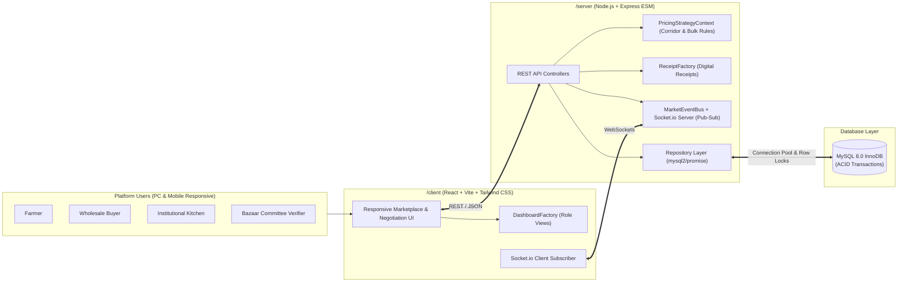

# Khamari (খামারি) — Direct-to-Buyer Agricultural Marketplace

**Khamari** is a cross-platform (PC & Mobile responsive) agricultural marketplace that connects **local farmers** directly with **wholesale buyers**, **institutional kitchens**, and **Local Bazaar Committees** (authoritative daily price verifiers). By eliminating exploitative multi-layer middlemen (*syndicates/farias*) and anchoring every listing and negotiation to verified regional wholesale price corridors, Khamari ensures fair farm-gate earnings and transparent bulk procurement.

---

## Key Platform Actors & Capabilities

| Role | Actor Type | Core Capabilities |
| :--- | :--- | :--- |
| **`FARMER`** | Local Agricultural Producer | List harvest batches (`KG`, `MAUND`, `TON`), configure wholesale bulk discount thresholds, negotiate live with buyers, and track order fulfillment. |
| **`BUYER`** | Wholesale Trader / Depot | Browse regional harvest batches benchmarked against verified Bazaar prices, negotiate bulk pricing in real time, and receive gate-pass trade receipts. |
| **`INSTITUTION`** | Institutional Kitchen (Hospitals, Universities, Dining Halls) | Procure high-volume agricultural produce using automated institutional contract discounts and receive tax-exempt procurement invoices. |
| **`BAZAAR_COMMITTEE`** | Regional Market Regulator / Price Verifier | Publish and verify daily regional wholesale price corridors (`min_price`, `modal_price`, `max_price`) and broadcast real-time market alerts. |

---

## Engineering Documentation (`/docs`)

Before writing application code, the complete software engineering architecture for Khamari is documented in `/docs`:

1. **[SDLC Plan (`docs/SDLC_PLAN.md`)](./docs/SDLC_PLAN.md)**
   - Selects and justifies the **Agile / Iterative & Incremental SDLC Model** over Waterfall and Spiral for Khamari's multi-role, mobile-first agricultural marketplace.
   - Maps all 6 SDLC phases and 4 implementation sprints with concrete deliverables and a risk mitigation matrix.
2. **[Database Design (`docs/DATABASE_DESIGN.md`)](./docs/DATABASE_DESIGN.md)**
   - Compares **Relational (SQL / MySQL)** vs. **NoSQL** databases for agricultural commerce, justifying MySQL (`InnoDB`) for ACID crop order settlement (`SELECT ... FOR UPDATE` row locking) and strict referential integrity.
   - Includes 1NF–3NF normalization verification, a Mermaid.js Entity-Relationship diagram, and complete DDL schemas for `Users`, `BazaarPrices`, `Crops`, `Negotiations`, `Messages`, and `Orders`.
3. **[Software Design Patterns (`docs/DESIGN_PATTERNS.md`)](./docs/DESIGN_PATTERNS.md)**
   - Details the architecture, UML class/sequence diagrams, and JavaScript (ESM) + React JSX implementation blueprints for four core patterns:
     - **Repository Pattern**: Clean `mysql2/promise` data access layer and transactional unit-of-work.
     - **Observer / Pub-Sub Pattern**: Event-driven Socket.io room broadcaster for live negotiation chat and regional Bazaar price alerts.
     - **Strategy Pattern**: Pluggable pricing corridor validation and dynamic wholesale/institutional bulk discount calculation.
     - **Factory Pattern**: Role-specific React dashboard rendering (`DashboardFactory`) and digital order receipt generation (`ReceiptFactory`).

---

## System Architecture Overview



---

## Technology Stack

- **Frontend (`/client`)**: React 18+ (JSX, ES Modules), Vite, Tailwind CSS (Mobile-first responsive design), Socket.io Client, Lucide Icons.
- **Backend (`/server`)**: Node.js, Express.js (ES Modules), Socket.io (Real-time rooms), JWT Authentication & Role-Based Access Control (RBAC).
- **Database**: MySQL 8.0+ (`InnoDB` engine) accessed via raw parameterized SQL using the `mysql2/promise` connection pool inside the Repository Pattern.

---

## Repository Directory Structure

```text
Khamari/
├── client/                     # React + Vite frontend workspace (PC & Mobile responsive)
│   └── .gitkeep
├── server/                     # Node.js + Express + Socket.io + MySQL backend workspace
│   └── .gitkeep
├── docs/                       # Core Software Engineering Specifications
│   ├── SDLC_PLAN.md            # Agile/Iterative SDLC justification & phase roadmap
│   ├── DATABASE_DESIGN.md      # SQL vs NoSQL analysis, 3NF ER diagram, & MySQL DDL schemas
│   └── DESIGN_PATTERNS.md      # Repository, Observer, Strategy, & Factory pattern specs
└── README.md                   # Project overview & architecture guide
```

---

## Local Environment Prerequisites (For Upcoming Implementation Phase)

1. **Node.js**: `v18.18+` or `v20+ LTS`
2. **MySQL Server**: `v8.0+` running locally (default port `3306`)
3. **Database Initialization**:
   Execute the SQL schema defined in [`docs/DATABASE_DESIGN.md`](./docs/DATABASE_DESIGN.md#6-complete-mysql-ddl-schema-schemasql) to create `khamari_db` and its 6 normalized tables (`Users`, `BazaarPrices`, `Crops`, `Negotiations`, `Messages`, `Orders`).
