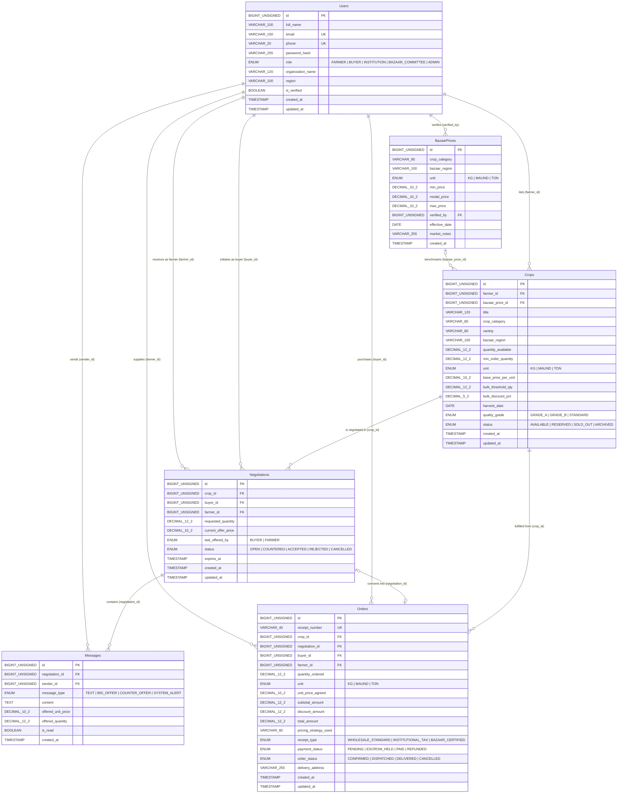

# Database Design & Architecture — Khamari

> **Database Engine**: MySQL 8.0+ (`InnoDB` Storage Engine)  
> **Driver / Access Layer**: `mysql2/promise` Connection Pool via the Repository Pattern  
> **Normalization Level**: Third Normal Form (3NF)  

---

## 1. Relational (SQL) vs. NoSQL Database Comparison for Khamari

Agricultural commerce on **Khamari** combines four tightly coupled data domains:
1. **Regulated Reference Data** (`BazaarPrices` verified daily by Local Bazaar Committees).
2. **Inventory-Constrained Asset Listings** (`Crops` with finite harvest weight in `kg`/`maund`/`ton`).
3. **Stateful Multi-Party Bargaining** (`Negotiations` and real-time `Messages` between Buyers and Farmers).
4. **Financial & Fulfillment Ledger** (`Orders` with immutable pricing snapshots and digital receipt codes).

### 1.1 Architectural Trade-Off Matrix

| Workload Requirement | **Relational DBMS — MySQL (`InnoDB`)** | **NoSQL — Document Store (e.g., MongoDB)** | **Winner for Khamari** |
| :--- | :--- | :--- | :--- |
| **Concurrent Crop Inventory Deduction** | Native row-level locking (`SELECT ... FOR UPDATE`) inside ACID transactions prevents double-selling when two buyers checkout the same crop batch simultaneously. | Requires multi-document transactions (higher overhead) or optimistic concurrency retry loops in application code if Orders and Crops are separate collections. | **MySQL** |
| **Bazaar Price Verification & Joins** | Fast, indexed relational `JOIN`s between `Crops`, `BazaarPrices`, and `Users` to compute real-time price compliance and regional market analytics. | Requires `$lookup` aggregation pipelines across collections or data duplication (denormalization) that goes stale when a Bazaar Committee updates daily prices. | **MySQL** |
| **Referential Integrity** | Strict `FOREIGN KEY` constraints guarantee that no `Order`, `Negotiation`, or `Message` can reference a non-existent `User` or `Crop`, and prevent accidental deletion of users with active orders (`ON DELETE RESTRICT`). | No native cross-collection foreign-key enforcement at the storage engine level; orphan records must be prevented manually in Node.js application code. | **MySQL** |
| **Schema Predictability & Financial Auditing** | Strict column types (`DECIMAL(12,2)` for currency/weights, `ENUM` for status state machines, `CHECK` constraints for non-negative stock) prevent malformed financial entries. | Schema-flexible by default; unless strict JSON Schema validation is maintained on every collection, inconsistent field types can corrupt financial totals. | **MySQL** |
| **Complex Analytical Reporting** | Rich SQL window functions, `GROUP BY` aggregations, and regional price variance queries run natively at the DB layer. | Requires complex multi-stage aggregation pipelines. | **MySQL** |

---

## 2. Why MySQL (`InnoDB`) Fits Best for Khamari

### 2.1 ACID Guarantees for Crop Orders & Inventory Protection
When a wholesale buyer or institutional kitchen finalizes a deal—either via direct bulk purchase or by accepting a negotiation counter-offer—four database mutations must succeed or fail as a **single atomic unit**:
1. Lock the target `Crops` row and verify `quantity_available >= requested_quantity`.
2. Deduct `requested_quantity` from `Crops.quantity_available` (and transition `Crops.status` to `'SOLD_OUT'` if stock hits `0`).
3. Transition `Negotiations.status` to `'ACCEPTED'` (if originating from a negotiation).
4. Insert an immutable financial record into `Orders` with a unique `receipt_number`.

With **MySQL InnoDB**:
- **Atomicity**: If inserting the `Orders` record fails or stock is insufficient, the entire transaction rolls back cleanly (`ROLLBACK`), leaving inventory untouched.
- **Consistency**: Database-level `CHECK (quantity_available >= 0)` and `CHECK (min_price <= modal_price AND modal_price <= max_price)` constraints guarantee valid domain states at all times.
- **Isolation**: `REPEATABLE READ` isolation combined with `SELECT ... FOR UPDATE` serializes concurrent checkouts against the same harvest batch.
- **Durability**: Committed orders and verified bazaar prices are persisted to the InnoDB redo log, protecting financial records against server crashes.

### 2.2 Authoritative Price Verification Lineage
Local Bazaar Committees act as market regulators. Every `BazaarPrices` entry records `verified_by` (referencing `Users.id` of a `BAZAAR_COMMITTEE` member), `crop_category`, `bazaar_region`, and the official daily price corridor (`min_price`, `modal_price`, `max_price`). Because `Crops` links directly to `BazaarPrices` (or joins by `crop_category` + `bazaar_region`), Khamari can dynamically verify whether any farmer's asking price or buyer's bid falls within the verified fair-trade corridor without risking stale denormalized price copies.

---

## 3. Normalization Verification (1NF → 2NF → 3NF)

1. **First Normal Form (1NF)**:
   - Every table has an atomic primary key (`id BIGINT UNSIGNED AUTO_INCREMENT`).
   - All attributes hold atomic scalar values (no comma-separated lists of messages or embedded arrays of orders). Multi-party conversations are normalized into `Negotiations` (1-to-many) and `Messages` (1-to-many).
2. **Second Normal Form (2NF)**:
   - Every table is in 1NF and uses a single-column surrogate primary key (`id`), eliminating any partial dependency on a composite primary key. Natural composite uniqueness (such as one active verified price per `(crop_category, bazaar_region, effective_date)`) is enforced via `UNIQUE KEY` constraints.
3. **Third Normal Form (3NF)**:
   - No non-key column transitively depends on another non-key column:
     - Farmer and Buyer names/phones are stored solely in `Users`, not duplicated inside `Crops`, `Negotiations`, or `Messages`.
     - Regional bazaar reference bounds (`min_price`, `modal_price`, `max_price`) live exclusively in `BazaarPrices` and are referenced via `bazaar_price_id` in `Crops`.
     - *Intentional Historical Snapshot Note*: In `Orders`, `unit_price_agreed`, `discount_amount`, and `total_amount` are stored as immutable point-in-time financial facts of the completed trade, because future changes to a crop's asking price must never alter past order receipts.

---

## 4. Entity-Relationship Diagram (Mermaid.js)



---

## 5. Detailed Table Specifications

### 5.1 `Users` Table
Stores all platform actors: local farmers, wholesale buyers, institutional kitchens, Bazaar Committee price verifiers, and administrators.

| Column | Data Type | Constraints | Description |
| :--- | :--- | :--- | :--- |
| `id` | `BIGINT UNSIGNED` | `PRIMARY KEY`, `AUTO_INCREMENT` | Unique user identifier. |
| `full_name` | `VARCHAR(100)` | `NOT NULL` | Full legal or display name of the user. |
| `email` | `VARCHAR(150)` | `NOT NULL`, `UNIQUE` | Login email address. |
| `phone` | `VARCHAR(20)` | `NOT NULL`, `UNIQUE` | Mobile number for SMS/trade verification. |
| `password_hash` | `VARCHAR(255)` | `NOT NULL` | Bcrypt-hashed password. |
| `role` | `ENUM(...)` | `NOT NULL` | `'FARMER'`, `'BUYER'`, `'INSTITUTION'`, `'BAZAAR_COMMITTEE'`, `'ADMIN'`. |
| `organization_name` | `VARCHAR(120)` | `NULL` | Trade license name, institutional kitchen name, or Bazaar Committee name. |
| `region` | `VARCHAR(100)` | `NOT NULL` | Primary agricultural district / bazaar hub (e.g., `'Bogura'`, `'Dhaka - Karwan Bazar'`). |
| `is_verified` | `BOOLEAN` | `NOT NULL`, `DEFAULT FALSE` | Indicates whether KYC / Bazaar Committee credentials are verified. |
| `created_at` | `TIMESTAMP` | `DEFAULT CURRENT_TIMESTAMP` | Account creation timestamp. |
| `updated_at` | `TIMESTAMP` | `ON UPDATE CURRENT_TIMESTAMP` | Last profile update timestamp. |

---

### 5.2 `BazaarPrices` Table
Stores official daily wholesale price bands published and verified by `BAZAAR_COMMITTEE` members for specific crops and regions.

| Column | Data Type | Constraints | Description |
| :--- | :--- | :--- | :--- |
| `id` | `BIGINT UNSIGNED` | `PRIMARY KEY`, `AUTO_INCREMENT` | Unique bazaar price record ID. |
| `crop_category` | `VARCHAR(80)` | `NOT NULL` | Standardized crop name (e.g., `'Potato (Diamond)'`, `'Miniket Rice'`, `'Onion (Deshi)'`). |
| `bazaar_region` | `VARCHAR(100)` | `NOT NULL` | Regional bazaar jurisdiction (e.g., `'Bogura'`, `'Rajshahi'`, `'Karwan Bazar'`). |
| `unit` | `ENUM('KG','MAUND','TON')` | `NOT NULL`, `DEFAULT 'KG'` | Standard measurement unit for the price band. |
| `min_price` | `DECIMAL(10,2)` | `NOT NULL`, `CHECK (min_price > 0)` | Verified floor wholesale price per unit (in BDT `৳`). |
| `modal_price` | `DECIMAL(10,2)` | `NOT NULL` | Most common (equilibrium) market trade price per unit. |
| `max_price` | `DECIMAL(10,2)` | `NOT NULL` | Verified ceiling wholesale price per unit (anti-hoarding cap). |
| `verified_by` | `BIGINT UNSIGNED` | `NOT NULL`, `FK -> Users(id)` | The `BAZAAR_COMMITTEE` official who published this rate. |
| `effective_date` | `DATE` | `NOT NULL` | Calendar date for which this price corridor is authoritative. |
| `market_notes` | `VARCHAR(255)` | `NULL` | Optional supply/weather commentary from the Bazaar Committee. |
| `created_at` | `TIMESTAMP` | `DEFAULT CURRENT_TIMESTAMP` | Publication timestamp. |

---

### 5.3 `Crops` Table
Represents harvest batches listed by farmers, linked to regional `BazaarPrices` benchmarks and configured with optional wholesale bulk discount rules.

| Column | Data Type | Constraints | Description |
| :--- | :--- | :--- | :--- |
| `id` | `BIGINT UNSIGNED` | `PRIMARY KEY`, `AUTO_INCREMENT` | Unique crop batch listing ID. |
| `farmer_id` | `BIGINT UNSIGNED` | `NOT NULL`, `FK -> Users(id)` | Farmer who owns and listed the harvest batch. |
| `bazaar_price_id` | `BIGINT UNSIGNED` | `NULL`, `FK -> BazaarPrices(id)` | Reference to the active regional Bazaar price benchmark at listing time. |
| `title` | `VARCHAR(120)` | `NOT NULL` | Listing headline (e.g., `'Fresh Harvest Bogura Diamond Potatoes'`). |
| `crop_category` | `VARCHAR(80)` | `NOT NULL` | Standardized crop category matching `BazaarPrices.crop_category`. |
| `variety` | `VARCHAR(80)` | `NULL` | Specific seed/cultivar variety (e.g., `'Cardinal'`, `'BRRI Dhan-28'`). |
| `bazaar_region` | `VARCHAR(100)` | `NOT NULL` | Origin bazaar/district of the harvest. |
| `quantity_available` | `DECIMAL(12,2)` | `NOT NULL`, `CHECK (quantity_available >= 0)` | Live remaining stock available for purchase. |
| `min_order_quantity` | `DECIMAL(12,2)` | `NOT NULL`, `DEFAULT 10.00` | Minimum wholesale quantity a buyer must order. |
| `unit` | `ENUM('KG','MAUND','TON')` | `NOT NULL`, `DEFAULT 'KG'` | Measurement unit for quantity and unit price. |
| `base_price_per_unit` | `DECIMAL(10,2)` | `NOT NULL`, `CHECK (base_price_per_unit > 0)` | Farmer's baseline asking price per unit (in BDT `৳`). |
| `bulk_threshold_qty` | `DECIMAL(12,2)` | `NULL` | Quantity threshold that unlocks bulk wholesale discount (e.g., `500.00` KG). |
| `bulk_discount_pct` | `DECIMAL(5,2)` | `NOT NULL`, `DEFAULT 0.00` | Percentage discount applied when order meets `bulk_threshold_qty` (e.g., `5.00`%). |
| `harvest_date` | `DATE` | `NOT NULL` | Date the crop batch was harvested. |
| `quality_grade` | `ENUM(...)` | `NOT NULL`, `DEFAULT 'GRADE_A'` | `'GRADE_A'`, `'GRADE_B'`, or `'STANDARD'`. |
| `status` | `ENUM(...)` | `NOT NULL`, `DEFAULT 'AVAILABLE'` | `'AVAILABLE'`, `'RESERVED'`, `'SOLD_OUT'`, `'ARCHIVED'`. |
| `created_at` | `TIMESTAMP` | `DEFAULT CURRENT_TIMESTAMP` | Listing creation time. |
| `updated_at` | `TIMESTAMP` | `ON UPDATE CURRENT_TIMESTAMP` | Last inventory or price update time. |

---

### 5.4 `Negotiations` Table
Tracks structured wholesale bargaining sessions between a specific Buyer (`BUYER` or `INSTITUTION`) and a Farmer over a specific `Crop` batch.

| Column | Data Type | Constraints | Description |
| :--- | :--- | :--- | :--- |
| `id` | `BIGINT UNSIGNED` | `PRIMARY KEY`, `AUTO_INCREMENT` | Unique negotiation room ID. |
| `crop_id` | `BIGINT UNSIGNED` | `NOT NULL`, `FK -> Crops(id)` | Target crop batch being negotiated. |
| `buyer_id` | `BIGINT UNSIGNED` | `NOT NULL`, `FK -> Users(id)` | Wholesale or institutional buyer initiating the bid. |
| `farmer_id` | `BIGINT UNSIGNED` | `NOT NULL`, `FK -> Users(id)` | Farmer owning the crop listing. |
| `requested_quantity` | `DECIMAL(12,2)` | `NOT NULL`, `CHECK (requested_quantity > 0)` | Quantity currently proposed in the negotiation. |
| `current_offer_price` | `DECIMAL(10,2)` | `NOT NULL`, `CHECK (current_offer_price > 0)` | Latest proposed unit price (in BDT `৳`). |
| `last_offered_by` | `ENUM('BUYER','FARMER')` | `NOT NULL` | Tracks whose turn it is to respond or accept. |
| `status` | `ENUM(...)` | `NOT NULL`, `DEFAULT 'OPEN'` | `'OPEN'`, `'COUNTERED'`, `'ACCEPTED'`, `'REJECTED'`, `'CANCELLED'`. |
| `expires_at` | `TIMESTAMP` | `NULL` | Optional expiration window for time-sensitive agricultural bids. |
| `created_at` | `TIMESTAMP` | `DEFAULT CURRENT_TIMESTAMP` | Negotiation start timestamp. |
| `updated_at` | `TIMESTAMP` | `ON UPDATE CURRENT_TIMESTAMP` | Timestamp of last offer/status change. |

---

### 5.5 `Messages` Table
Stores the chronological audit trail of chat messages, structured bids, counter-offers, and system alerts inside a `Negotiation` room.

| Column | Data Type | Constraints | Description |
| :--- | :--- | :--- | :--- |
| `id` | `BIGINT UNSIGNED` | `PRIMARY KEY`, `AUTO_INCREMENT` | Unique message ID. |
| `negotiation_id` | `BIGINT UNSIGNED` | `NOT NULL`, `FK -> Negotiations(id)` | Parent negotiation room. |
| `sender_id` | `BIGINT UNSIGNED` | `NOT NULL`, `FK -> Users(id)` | User who sent the message or counter-offer. |
| `message_type` | `ENUM(...)` | `NOT NULL`, `DEFAULT 'TEXT'` | `'TEXT'`, `'BID_OFFER'`, `'COUNTER_OFFER'`, `'SYSTEM_ALERT'`. |
| `content` | `TEXT` | `NOT NULL` | Message body or system event description. |
| `offered_unit_price` | `DECIMAL(10,2)` | `NULL` | Populated if `message_type` is `'BID_OFFER'` or `'COUNTER_OFFER'`. |
| `offered_quantity` | `DECIMAL(12,2)` | `NULL` | Populated if the offer modifies the requested volume. |
| `is_read` | `BOOLEAN` | `NOT NULL`, `DEFAULT FALSE` | Read receipt flag for real-time chat UI. |
| `created_at` | `TIMESTAMP` | `DEFAULT CURRENT_TIMESTAMP` | Exact message timestamp. |

---

### 5.6 `Orders` Table
Stores finalized, ACID-verified wholesale transactions and metadata needed by the `ReceiptFactory` to generate digital trade receipts.

| Column | Data Type | Constraints | Description |
| :--- | :--- | :--- | :--- |
| `id` | `BIGINT UNSIGNED` | `PRIMARY KEY`, `AUTO_INCREMENT` | Unique order ID. |
| `receipt_number` | `VARCHAR(40)` | `NOT NULL`, `UNIQUE` | Human-readable verifiable receipt code (e.g., `'KHM-20261115-00042'`). |
| `crop_id` | `BIGINT UNSIGNED` | `NOT NULL`, `FK -> Crops(id)` | Purchased crop listing. |
| `negotiation_id` | `BIGINT UNSIGNED` | `NULL`, `UNIQUE`, `FK -> Negotiations(id)` | Source negotiation (nullable for direct buy-now wholesale orders). |
| `buyer_id` | `BIGINT UNSIGNED` | `NOT NULL`, `FK -> Users(id)` | Purchasing wholesale buyer or institutional kitchen. |
| `farmer_id` | `BIGINT UNSIGNED` | `NOT NULL`, `FK -> Users(id)` | Selling farmer. |
| `quantity_ordered` | `DECIMAL(12,2)` | `NOT NULL`, `CHECK (quantity_ordered > 0)` | Final confirmed quantity deducted from `Crops.quantity_available`. |
| `unit` | `ENUM('KG','MAUND','TON')` | `NOT NULL` | Unit snapshot at order time. |
| `unit_price_agreed` | `DECIMAL(10,2)` | `NOT NULL`, `CHECK (unit_price_agreed > 0)` | Agreed price per unit before strategy discounts. |
| `subtotal_amount` | `DECIMAL(12,2)` | `NOT NULL` | `quantity_ordered * unit_price_agreed`. |
| `discount_amount` | `DECIMAL(12,2)` | `NOT NULL`, `DEFAULT 0.00` | Bulk or institutional discount calculated by the Strategy Pattern. |
| `total_amount` | `DECIMAL(12,2)` | `NOT NULL` | Final net payable amount (`subtotal_amount - discount_amount`). |
| `pricing_strategy_used` | `VARCHAR(60)` | `NOT NULL` | Audit tag (e.g., `'BULK_TIER_DISCOUNT'`, `'INSTITUTIONAL_CONTRACT'`, `'NEGOTIATED_SPOT'`). |
| `receipt_type` | `ENUM(...)` | `NOT NULL` | `'WHOLESALE_STANDARD'`, `'INSTITUTIONAL_TAX'`, `'BAZAAR_CERTIFIED'`. |
| `payment_status` | `ENUM(...)` | `NOT NULL`, `DEFAULT 'PENDING'` | `'PENDING'`, `'ESCROW_HELD'`, `'PAID'`, `'REFUNDED'`. |
| `order_status` | `ENUM(...)` | `NOT NULL`, `DEFAULT 'CONFIRMED'` | `'CONFIRMED'`, `'DISPATCHED'`, `'DELIVERED'`, `'CANCELLED'`. |
| `delivery_address` | `VARCHAR(255)` | `NOT NULL` | Destination warehouse or institutional kitchen address. |
| `created_at` | `TIMESTAMP` | `DEFAULT CURRENT_TIMESTAMP` | Order confirmation timestamp. |
| `updated_at` | `TIMESTAMP` | `ON UPDATE CURRENT_TIMESTAMP` | Last fulfillment status update timestamp. |

---

## 6. Complete MySQL DDL Schema (`schema.sql`)

```sql
-- ============================================================================
-- Khamari Agricultural Marketplace — MySQL 8.0+ Relational Schema (3NF)
-- Storage Engine: InnoDB (ACID Compliant, Row-Level Locking, Foreign Keys)
-- ============================================================================

CREATE DATABASE IF NOT EXISTS khamari_db
  CHARACTER SET utf8mb4
  COLLATE utf8mb4_unicode_ci;

USE khamari_db;

-- ----------------------------------------------------------------------------
-- 1. Users Table
-- ----------------------------------------------------------------------------
CREATE TABLE IF NOT EXISTS Users (
    id BIGINT UNSIGNED AUTO_INCREMENT PRIMARY KEY,
    full_name VARCHAR(100) NOT NULL,
    email VARCHAR(150) NOT NULL,
    phone VARCHAR(20) NOT NULL,
    password_hash VARCHAR(255) NOT NULL,
    role ENUM('FARMER', 'BUYER', 'INSTITUTION', 'BAZAAR_COMMITTEE', 'ADMIN') NOT NULL,
    organization_name VARCHAR(120) NULL,
    region VARCHAR(100) NOT NULL,
    is_verified BOOLEAN NOT NULL DEFAULT FALSE,
    created_at TIMESTAMP NOT NULL DEFAULT CURRENT_TIMESTAMP,
    updated_at TIMESTAMP NOT NULL DEFAULT CURRENT_TIMESTAMP ON UPDATE CURRENT_TIMESTAMP,

    CONSTRAINT uq_users_email UNIQUE (email),
    CONSTRAINT uq_users_phone UNIQUE (phone),
    INDEX idx_users_role_region (role, region)
) ENGINE=InnoDB DEFAULT CHARSET=utf8mb4 COLLATE=utf8mb4_unicode_ci;

-- ----------------------------------------------------------------------------
-- 2. BazaarPrices Table
-- ----------------------------------------------------------------------------
CREATE TABLE IF NOT EXISTS BazaarPrices (
    id BIGINT UNSIGNED AUTO_INCREMENT PRIMARY KEY,
    crop_category VARCHAR(80) NOT NULL,
    bazaar_region VARCHAR(100) NOT NULL,
    unit ENUM('KG', 'MAUND', 'TON') NOT NULL DEFAULT 'KG',
    min_price DECIMAL(10, 2) NOT NULL,
    modal_price DECIMAL(10, 2) NOT NULL,
    max_price DECIMAL(10, 2) NOT NULL,
    verified_by BIGINT UNSIGNED NOT NULL,
    effective_date DATE NOT NULL,
    market_notes VARCHAR(255) NULL,
    created_at TIMESTAMP NOT NULL DEFAULT CURRENT_TIMESTAMP,

    CONSTRAINT fk_bazaar_prices_verifier
        FOREIGN KEY (verified_by) REFERENCES Users(id)
        ON DELETE RESTRICT ON UPDATE CASCADE,
    CONSTRAINT chk_bazaar_price_corridor
        CHECK (min_price > 0 AND min_price <= modal_price AND modal_price <= max_price),
    CONSTRAINT uq_bazaar_daily_crop_region
        UNIQUE (crop_category, bazaar_region, unit, effective_date),
    INDEX idx_bazaar_lookup (crop_category, bazaar_region, effective_date DESC)
) ENGINE=InnoDB DEFAULT CHARSET=utf8mb4 COLLATE=utf8mb4_unicode_ci;

-- ----------------------------------------------------------------------------
-- 3. Crops Table
-- ----------------------------------------------------------------------------
CREATE TABLE IF NOT EXISTS Crops (
    id BIGINT UNSIGNED AUTO_INCREMENT PRIMARY KEY,
    farmer_id BIGINT UNSIGNED NOT NULL,
    bazaar_price_id BIGINT UNSIGNED NULL,
    title VARCHAR(120) NOT NULL,
    crop_category VARCHAR(80) NOT NULL,
    variety VARCHAR(80) NULL,
    bazaar_region VARCHAR(100) NOT NULL,
    quantity_available DECIMAL(12, 2) NOT NULL,
    min_order_quantity DECIMAL(12, 2) NOT NULL DEFAULT 10.00,
    unit ENUM('KG', 'MAUND', 'TON') NOT NULL DEFAULT 'KG',
    base_price_per_unit DECIMAL(10, 2) NOT NULL,
    bulk_threshold_qty DECIMAL(12, 2) NULL,
    bulk_discount_pct DECIMAL(5, 2) NOT NULL DEFAULT 0.00,
    harvest_date DATE NOT NULL,
    quality_grade ENUM('GRADE_A', 'GRADE_B', 'STANDARD') NOT NULL DEFAULT 'GRADE_A',
    status ENUM('AVAILABLE', 'RESERVED', 'SOLD_OUT', 'ARCHIVED') NOT NULL DEFAULT 'AVAILABLE',
    created_at TIMESTAMP NOT NULL DEFAULT CURRENT_TIMESTAMP,
    updated_at TIMESTAMP NOT NULL DEFAULT CURRENT_TIMESTAMP ON UPDATE CURRENT_TIMESTAMP,

    CONSTRAINT fk_crops_farmer
        FOREIGN KEY (farmer_id) REFERENCES Users(id)
        ON DELETE RESTRICT ON UPDATE CASCADE,
    CONSTRAINT fk_crops_bazaar_price
        FOREIGN KEY (bazaar_price_id) REFERENCES BazaarPrices(id)
        ON DELETE SET NULL ON UPDATE CASCADE,
    CONSTRAINT chk_crops_quantities
        CHECK (quantity_available >= 0 AND min_order_quantity > 0),
    CONSTRAINT chk_crops_pricing
        CHECK (base_price_per_unit > 0 AND bulk_discount_pct >= 0.00 AND bulk_discount_pct <= 50.00),
    INDEX idx_crops_marketplace (status, crop_category, bazaar_region),
    INDEX idx_crops_farmer (farmer_id, status)
) ENGINE=InnoDB DEFAULT CHARSET=utf8mb4 COLLATE=utf8mb4_unicode_ci;

-- ----------------------------------------------------------------------------
-- 4. Negotiations Table
-- ----------------------------------------------------------------------------
CREATE TABLE IF NOT EXISTS Negotiations (
    id BIGINT UNSIGNED AUTO_INCREMENT PRIMARY KEY,
    crop_id BIGINT UNSIGNED NOT NULL,
    buyer_id BIGINT UNSIGNED NOT NULL,
    farmer_id BIGINT UNSIGNED NOT NULL,
    requested_quantity DECIMAL(12, 2) NOT NULL,
    current_offer_price DECIMAL(10, 2) NOT NULL,
    last_offered_by ENUM('BUYER', 'FARMER') NOT NULL,
    status ENUM('OPEN', 'COUNTERED', 'ACCEPTED', 'REJECTED', 'CANCELLED') NOT NULL DEFAULT 'OPEN',
    expires_at TIMESTAMP NULL,
    created_at TIMESTAMP NOT NULL DEFAULT CURRENT_TIMESTAMP,
    updated_at TIMESTAMP NOT NULL DEFAULT CURRENT_TIMESTAMP ON UPDATE CURRENT_TIMESTAMP,

    CONSTRAINT fk_negotiations_crop
        FOREIGN KEY (crop_id) REFERENCES Crops(id)
        ON DELETE RESTRICT ON UPDATE CASCADE,
    CONSTRAINT fk_negotiations_buyer
        FOREIGN KEY (buyer_id) REFERENCES Users(id)
        ON DELETE RESTRICT ON UPDATE CASCADE,
    CONSTRAINT fk_negotiations_farmer
        FOREIGN KEY (farmer_id) REFERENCES Users(id)
        ON DELETE RESTRICT ON UPDATE CASCADE,
    CONSTRAINT chk_negotiations_positive
        CHECK (requested_quantity > 0 AND current_offer_price > 0),
    INDEX idx_negotiations_crop_status (crop_id, status),
    INDEX idx_negotiations_buyer (buyer_id, status),
    INDEX idx_negotiations_farmer (farmer_id, status)
) ENGINE=InnoDB DEFAULT CHARSET=utf8mb4 COLLATE=utf8mb4_unicode_ci;

-- ----------------------------------------------------------------------------
-- 5. Messages Table
-- ----------------------------------------------------------------------------
CREATE TABLE IF NOT EXISTS Messages (
    id BIGINT UNSIGNED AUTO_INCREMENT PRIMARY KEY,
    negotiation_id BIGINT UNSIGNED NOT NULL,
    sender_id BIGINT UNSIGNED NOT NULL,
    message_type ENUM('TEXT', 'BID_OFFER', 'COUNTER_OFFER', 'SYSTEM_ALERT') NOT NULL DEFAULT 'TEXT',
    content TEXT NOT NULL,
    offered_unit_price DECIMAL(10, 2) NULL,
    offered_quantity DECIMAL(12, 2) NULL,
    is_read BOOLEAN NOT NULL DEFAULT FALSE,
    created_at TIMESTAMP NOT NULL DEFAULT CURRENT_TIMESTAMP,

    CONSTRAINT fk_messages_negotiation
        FOREIGN KEY (negotiation_id) REFERENCES Negotiations(id)
        ON DELETE CASCADE ON UPDATE CASCADE,
    CONSTRAINT fk_messages_sender
        FOREIGN KEY (sender_id) REFERENCES Users(id)
        ON DELETE RESTRICT ON UPDATE CASCADE,
    INDEX idx_messages_negotiation_time (negotiation_id, created_at ASC)
) ENGINE=InnoDB DEFAULT CHARSET=utf8mb4 COLLATE=utf8mb4_unicode_ci;

-- ----------------------------------------------------------------------------
-- 6. Orders Table
-- ----------------------------------------------------------------------------
CREATE TABLE IF NOT EXISTS Orders (
    id BIGINT UNSIGNED AUTO_INCREMENT PRIMARY KEY,
    receipt_number VARCHAR(40) NOT NULL,
    crop_id BIGINT UNSIGNED NOT NULL,
    negotiation_id BIGINT UNSIGNED NULL,
    buyer_id BIGINT UNSIGNED NOT NULL,
    farmer_id BIGINT UNSIGNED NOT NULL,
    quantity_ordered DECIMAL(12, 2) NOT NULL,
    unit ENUM('KG', 'MAUND', 'TON') NOT NULL,
    unit_price_agreed DECIMAL(10, 2) NOT NULL,
    subtotal_amount DECIMAL(12, 2) NOT NULL,
    discount_amount DECIMAL(12, 2) NOT NULL DEFAULT 0.00,
    total_amount DECIMAL(12, 2) NOT NULL,
    pricing_strategy_used VARCHAR(60) NOT NULL,
    receipt_type ENUM('WHOLESALE_STANDARD', 'INSTITUTIONAL_TAX', 'BAZAAR_CERTIFIED') NOT NULL,
    payment_status ENUM('PENDING', 'ESCROW_HELD', 'PAID', 'REFUNDED') NOT NULL DEFAULT 'PENDING',
    order_status ENUM('CONFIRMED', 'DISPATCHED', 'DELIVERED', 'CANCELLED') NOT NULL DEFAULT 'CONFIRMED',
    delivery_address VARCHAR(255) NOT NULL,
    created_at TIMESTAMP NOT NULL DEFAULT CURRENT_TIMESTAMP,
    updated_at TIMESTAMP NOT NULL DEFAULT CURRENT_TIMESTAMP ON UPDATE CURRENT_TIMESTAMP,

    CONSTRAINT uq_orders_receipt_number UNIQUE (receipt_number),
    CONSTRAINT uq_orders_negotiation UNIQUE (negotiation_id),
    CONSTRAINT fk_orders_crop
        FOREIGN KEY (crop_id) REFERENCES Crops(id)
        ON DELETE RESTRICT ON UPDATE CASCADE,
    CONSTRAINT fk_orders_negotiation
        FOREIGN KEY (negotiation_id) REFERENCES Negotiations(id)
        ON DELETE RESTRICT ON UPDATE CASCADE,
    CONSTRAINT fk_orders_buyer
        FOREIGN KEY (buyer_id) REFERENCES Users(id)
        ON DELETE RESTRICT ON UPDATE CASCADE,
    CONSTRAINT fk_orders_farmer
        FOREIGN KEY (farmer_id) REFERENCES Users(id)
        ON DELETE RESTRICT ON UPDATE CASCADE,
    CONSTRAINT chk_orders_amounts
        CHECK (quantity_ordered > 0 AND unit_price_agreed > 0 AND discount_amount >= 0 AND total_amount >= 0),
    INDEX idx_orders_buyer_created (buyer_id, created_at DESC),
    INDEX idx_orders_farmer_created (farmer_id, created_at DESC)
) ENGINE=InnoDB DEFAULT CHARSET=utf8mb4 COLLATE=utf8mb4_unicode_ci;
```

---

## 7. Reference ACID Transaction Blueprint (Order Settlement)

Below is the exact transactional SQL workflow executed when converting an accepted `Negotiation` into an `Order`:

```sql
START TRANSACTION;

-- Step 1: Acquire an exclusive row lock on the target Crop batch
SELECT id, quantity_available, status
FROM Crops
WHERE id = 104
FOR UPDATE;

-- Step 2: Application verifies quantity_available >= 500.00 KG and status = 'AVAILABLE'
-- Deduct stock and automatically mark SOLD_OUT if depleted
UPDATE Crops
SET quantity_available = quantity_available - 500.00,
    status = CASE
        WHEN (quantity_available - 500.00) = 0 THEN 'SOLD_OUT'
        ELSE 'AVAILABLE'
    END
WHERE id = 104;

-- Step 3: Mark the Negotiation as ACCEPTED
UPDATE Negotiations
SET status = 'ACCEPTED'
WHERE id = 58 AND status IN ('OPEN', 'COUNTERED');

-- Step 4: Insert the immutable Order record
INSERT INTO Orders (
    receipt_number, crop_id, negotiation_id, buyer_id, farmer_id,
    quantity_ordered, unit, unit_price_agreed, subtotal_amount,
    discount_amount, total_amount, pricing_strategy_used,
    receipt_type, payment_status, order_status, delivery_address
) VALUES (
    'KHM-20261115-00058', 104, 58, 12, 4,
    500.00, 'KG', 28.00, 14000.00,
    700.00, 13300.00, 'BULK_TIER_DISCOUNT',
    'WHOLESALE_STANDARD', 'ESCROW_HELD', 'CONFIRMED',
    'House 14, Shyamoli Wholesale Depot, Dhaka'
);

COMMIT;
```
