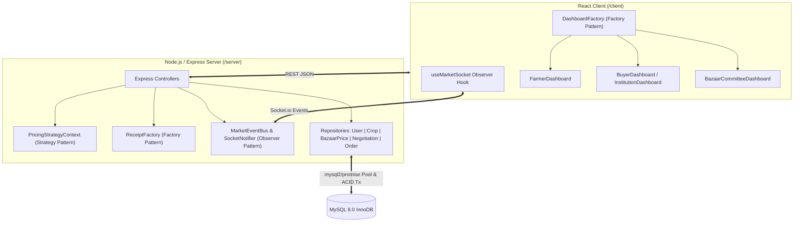
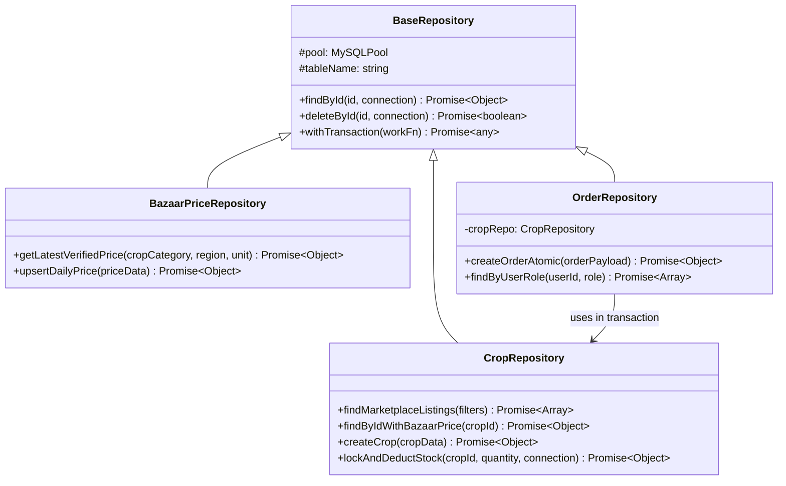
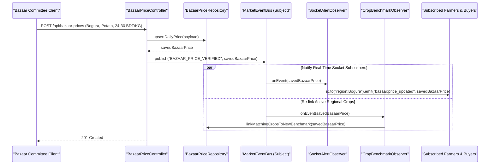
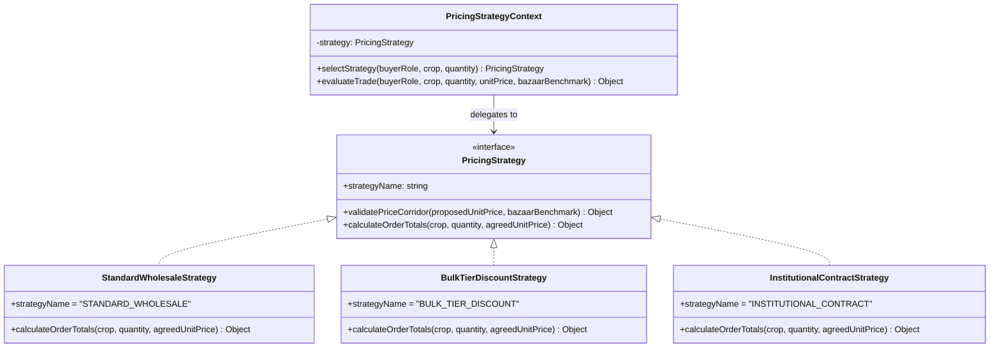
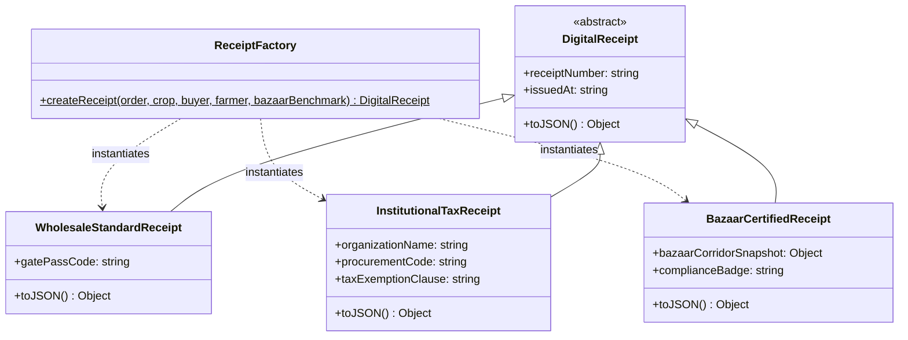

# Software Design Patterns Specification — Khamari

> **Architecture**: Layered Service-Repository Backend (Node.js/Express ESM) + Component-Driven Frontend (React JSX)  
> **Core Patterns Implemented**: Repository Pattern, Observer / Pub-Sub Pattern, Strategy Pattern, Factory Pattern  

---

## 1. Architectural Overview: How the 4 Patterns Collaborate

In **Khamari**, the four design patterns are not isolated academic exercises—they form a cohesive pipeline across the request lifecycle:
1. **Repository Pattern** isolates all raw `mysql2/promise` SQL queries and ACID transactions behind clean domain interfaces (`CropRepository`, `BazaarPriceRepository`, `NegotiationRepository`, `OrderRepository`).
2. **Strategy Pattern** plugs into the service layer to validate crop prices against regional `BazaarPrices` corridors and calculate dynamic wholesale or institutional discounts.
3. **Observer / Pub-Sub Pattern** decouples state mutations (such as a Bazaar Committee publishing a new price cap or a Buyer sending a counter-offer) from real-time Socket.io room broadcasts and React UI notifications.
4. **Factory Pattern** operates on both tiers:
   - **Backend (`ReceiptFactory`)**: Manufactures role-appropriate digital trade receipts (`WholesaleStandardReceipt`, `InstitutionalTaxReceipt`, `BazaarCertifiedReceipt`) upon order settlement.
   - **Frontend (`DashboardFactory`)**: Instantiates the correct role-specific workspace (`FarmerDashboard`, `BuyerDashboard`, `InstitutionDashboard`, `BazaarCommitteeDashboard`) based on the authenticated user's profile.



---

## 2. Pattern 1: Repository Pattern (Clean MySQL Data Access Layer)

### 2.1 Definition & Architectural Problem
Without a dedicated data access abstraction, Express controllers or route handlers become polluted with inline SQL strings, repetitive connection releases, and ad-hoc transaction error handling. If a column name in `Crops` or `Orders` changes, dozens of route files break.

The **Repository Pattern** mediates between the domain/service layer and the `mysql2/promise` connection pool, exposing collection-like asynchronous methods (`findById`, `findAvailableWithBazaarBenchmark`, `createOrderAtomic`) while hiding SQL dialect details.

### 2.2 Why It Fits Khamari
- **Centralized ACID Transaction Management**: `OrderRepository.createOrderAtomic()` encapsulates `connection.beginTransaction()`, `SELECT ... FOR UPDATE` row locking, stock deduction, and `commit()`/`rollback()` in one testable class.
- **Complex Relational Joins in One Place**: Joining `Crops` with the latest verified `BazaarPrices` and farmer metadata is written once inside `CropRepository`.
- **High Testability**: Services and controllers can be unit-tested by mocking repository methods without needing a live MySQL server.

### 2.3 Class Diagram



### 2.4 Implementation Blueprint (`/server/src/repositories/`)

```javascript
// server/src/repositories/BaseRepository.js
export class BaseRepository {
  constructor(pool, tableName) {
    this.pool = pool;
    this.tableName = tableName;
  }

  getExecutor(connection = null) {
    return connection || this.pool;
  }

  async findById(id, connection = null) {
    const executor = this.getExecutor(connection);
    const [rows] = await executor.execute(
      `SELECT * FROM ${this.tableName} WHERE id = ? LIMIT 1`,
      [id]
    );
    return rows[0] || null;
  }

  async withTransaction(workFn) {
    const connection = await this.pool.getConnection();
    try {
      await connection.beginTransaction();
      const result = await workFn(connection);
      await connection.commit();
      return result;
    } catch (error) {
      await connection.rollback();
      throw error;
    } finally {
      connection.release();
    }
  }
}
```

```javascript
// server/src/repositories/CropRepository.js
import { BaseRepository } from './BaseRepository.js';

export class CropRepository extends BaseRepository {
  constructor(pool) {
    super(pool, 'Crops');
  }

  async findByIdWithBazaarPrice(cropId, connection = null) {
    const executor = this.getExecutor(connection);
    const sql = `
      SELECT 
        c.*,
        u.full_name AS farmer_name,
        u.phone AS farmer_phone,
        bp.min_price AS bazaar_min_price,
        bp.modal_price AS bazaar_modal_price,
        bp.max_price AS bazaar_max_price,
        bp.effective_date AS bazaar_effective_date
      FROM Crops c
      INNER JOIN Users u ON u.id = c.farmer_id
      LEFT JOIN BazaarPrices bp ON bp.id = c.bazaar_price_id
      WHERE c.id = ?
      LIMIT 1
    `;
    const [rows] = await executor.execute(sql, [cropId]);
    return rows[0] || null;
  }

  async lockAndDeductStock(cropId, requestedQty, connection) {
    const [rows] = await connection.execute(
      `SELECT id, quantity_available, status, unit, base_price_per_unit
       FROM Crops WHERE id = ? FOR UPDATE`,
      [cropId]
    );

    const crop = rows[0];
    if (!crop || crop.status !== 'AVAILABLE') {
      throw new Error('CROP_UNAVAILABLE');
    }
    if (Number(crop.quantity_available) < Number(requestedQty)) {
      throw new Error('INSUFFICIENT_CROP_STOCK');
    }

    const remaining = Number(crop.quantity_available) - Number(requestedQty);
    const nextStatus = remaining === 0 ? 'SOLD_OUT' : 'AVAILABLE';

    await connection.execute(
      `UPDATE Crops SET quantity_available = ?, status = ? WHERE id = ?`,
      [remaining, nextStatus, cropId]
    );

    return { ...crop, quantity_available: remaining, status: nextStatus };
  }
}
```

---

## 3. Pattern 2: Observer / Pub-Sub Pattern (Real-Time Socket.io Chat & Bazaar Price Alerts)

### 3.1 Definition & Architectural Problem
In an active agricultural marketplace, multiple parties watch the same data streams simultaneously:
- When a **Bazaar Committee** member publishes a new daily price corridor for *Bogura Diamond Potatoes*, every farmer and buyer browsing the *Bogura* region must see the updated verified benchmark immediately without refreshing the page.
- When a **Buyer** submits a counter-offer inside a negotiation room, the **Farmer** must receive an instant chat card, unread badge update, and toast alert.

Hardcoding `io.to(...).emit(...)` directly inside database repositories or HTTP controllers tightly couples domain logic to WebSocket transport. The **Observer / Pub-Sub Pattern** introduces an event subject (`MarketEventBus`) to which multiple independent observers subscribe (e.g., `SocketRoomBroadcaster`, `SystemAlertMessageObserver`).

### 3.2 Sequence Diagram



### 3.3 Implementation Blueprint (`/server/src/events/` & `/client/src/hooks/`)

```javascript
// server/src/events/MarketEventBus.js
import { EventEmitter } from 'node:events';

export const MARKET_EVENTS = Object.freeze({
  BAZAAR_PRICE_VERIFIED: 'BAZAAR_PRICE_VERIFIED',
  NEGOTIATION_OFFER_POSTED: 'NEGOTIATION_OFFER_POSTED',
  NEGOTIATION_MESSAGE_SENT: 'NEGOTIATION_MESSAGE_SENT',
  ORDER_CONFIRMED: 'ORDER_CONFIRMED',
});

export class MarketEventBus {
  constructor() {
    this.emitter = new EventEmitter();
  }

  subscribe(eventName, observerFn) {
    this.emitter.on(eventName, observerFn);
    return () => this.emitter.off(eventName, observerFn);
  }

  publish(eventName, payload) {
    this.emitter.emit(eventName, {
      event: eventName,
      timestamp: new Date().toISOString(),
      data: payload,
    });
  }
}
```

```javascript
// server/src/events/SocketBroadcastObserver.js
import { MARKET_EVENTS } from './MarketEventBus.js';

export class SocketBroadcastObserver {
  constructor(io, eventBus) {
    this.io = io;
    this.eventBus = eventBus;
    this.registerSubscriptions();
  }

  registerSubscriptions() {
    // 1. Broadcast regional Bazaar Committee price verification alerts
    this.eventBus.subscribe(MARKET_EVENTS.BAZAAR_PRICE_VERIFIED, ({ data }) => {
      this.io.to(`region:${data.bazaar_region}`).emit('bazaar:price_updated', data);
      this.io.emit('bazaar:global_ticker', data);
    });

    // 2. Broadcast live negotiation chat messages & counter-offers
    this.eventBus.subscribe(MARKET_EVENTS.NEGOTIATION_MESSAGE_SENT, ({ data }) => {
      this.io
        .to(`negotiation:${data.negotiation_id}`)
        .emit('negotiation:new_message', data);
    });

    // 3. Broadcast order settlement alerts to both Buyer and Farmer
    this.eventBus.subscribe(MARKET_EVENTS.ORDER_CONFIRMED, ({ data }) => {
      this.io.to(`user:${data.buyer_id}`).emit('order:confirmed', data);
      this.io.to(`user:${data.farmer_id}`).emit('order:confirmed', data);
    });
  }
}
```

---

## 4. Pattern 3: Strategy Pattern (Dynamic Pricing Validation & Wholesale Bulk Discount Rules)

### 4.1 Definition & Architectural Problem
Pricing in **Khamari** is governed by multiple contextual rules:
1. **Bazaar Corridor Validation**: Is a farmer's asking price or buyer's bid within the Local Bazaar Committee's verified `[min_price, max_price]` corridor?
2. **Standard Wholesale Pricing**: Base unit price multiplied by ordered quantity when volume is below the bulk threshold.
3. **Bulk Tier Discount Pricing**: Automatic percentage discount when a wholesale buyer orders at or above `bulk_threshold_qty`.
4. **Institutional Contract Pricing**: Specialized tiered pricing for verified `INSTITUTION` buyers (e.g., university dining halls, hospitals, government granaries) ordering large volumes with waived platform fees and extra volume rebates.

Replacing sprawling `if/else` chains with the **Strategy Pattern** encapsulates each pricing algorithm into an interchangeable strategy class implementing a common `calculate(context)` and `validateCorridor(unitPrice, bazaarPrice)` interface.

### 4.2 Class Diagram



### 4.3 Implementation Blueprint (`/server/src/strategies/pricing/`)

```javascript
// server/src/strategies/pricing/PricingStrategies.js

export class BasePricingStrategy {
  constructor(strategyName) {
    this.strategyName = strategyName;
  }

  /**
   * Validates whether a proposed ask/bid price respects the Local Bazaar Committee corridor.
   */
  validatePriceCorridor(proposedUnitPrice, bazaarBenchmark) {
    if (!bazaarBenchmark) {
      return {
        isValid: true,
        complianceStatus: 'UNBENCHMARKED',
        message: 'No active Bazaar Committee benchmark for this crop/region today.',
      };
    }

    const price = Number(proposedUnitPrice);
    const min = Number(bazaarBenchmark.min_price);
    const max = Number(bazaarBenchmark.max_price);
    const modal = Number(bazaarBenchmark.modal_price);

    if (price < min) {
      return {
        isValid: false,
        complianceStatus: 'BELOW_FLOOR',
        message: `Proposed price (৳${price}) is below the Bazaar Committee minimum floor (৳${min}).`,
      };
    }

    if (price > max) {
      return {
        isValid: false,
        complianceStatus: 'ABOVE_CEILING',
        message: `Proposed price (৳${price}) exceeds the Bazaar Committee maximum cap (৳${max}).`,
      };
    }

    return {
      isValid: true,
      complianceStatus: 'BAZAAR_VERIFIED',
      varianceFromModalPct: Number((((price - modal) / modal) * 100).toFixed(2)),
      message: `Within verified Bazaar corridor (৳${min} - ৳${max}, Modal: ৳${modal}).`,
    };
  }
}

export class StandardWholesaleStrategy extends BasePricingStrategy {
  constructor() {
    super('STANDARD_WHOLESALE');
  }

  calculateOrderTotals(crop, quantity, agreedUnitPrice) {
    const qty = Number(quantity);
    const unitPrice = Number(agreedUnitPrice ?? crop.base_price_per_unit);
    const subtotal = Number((qty * unitPrice).toFixed(2));
    return {
      strategyUsed: this.strategyName,
      quantity: qty,
      unitPrice,
      subtotalAmount: subtotal,
      discountAmount: 0.0,
      totalAmount: subtotal,
    };
  }
}

export class BulkTierDiscountStrategy extends BasePricingStrategy {
  constructor() {
    super('BULK_TIER_DISCOUNT');
  }

  calculateOrderTotals(crop, quantity, agreedUnitPrice) {
    const qty = Number(quantity);
    const unitPrice = Number(agreedUnitPrice ?? crop.base_price_per_unit);
    const subtotal = Number((qty * unitPrice).toFixed(2));
    const discountPct = Number(crop.bulk_discount_pct || 0);
    const discountAmount = Number(((subtotal * discountPct) / 100).toFixed(2));

    return {
      strategyUsed: this.strategyName,
      quantity: qty,
      unitPrice,
      subtotalAmount: subtotal,
      discountAmount,
      totalAmount: Number((subtotal - discountAmount).toFixed(2)),
    };
  }
}

export class InstitutionalContractStrategy extends BasePricingStrategy {
  constructor() {
    super('INSTITUTIONAL_CONTRACT');
  }

  calculateOrderTotals(crop, quantity, agreedUnitPrice) {
    const qty = Number(quantity);
    const unitPrice = Number(agreedUnitPrice ?? crop.base_price_per_unit);
    const subtotal = Number((qty * unitPrice).toFixed(2));

    // Institutional kitchens receive the farmer's bulk discount + an additional 2% volume rebate
    const baseBulkPct =
      crop.bulk_threshold_qty && qty >= Number(crop.bulk_threshold_qty)
        ? Number(crop.bulk_discount_pct || 0)
        : 0;
    const effectiveDiscountPct = Math.min(baseBulkPct + 2.0, 25.0);
    const discountAmount = Number(((subtotal * effectiveDiscountPct) / 100).toFixed(2));

    return {
      strategyUsed: this.strategyName,
      quantity: qty,
      unitPrice,
      subtotalAmount: subtotal,
      discountAmount,
      totalAmount: Number((subtotal - discountAmount).toFixed(2)),
    };
  }
}

export class PricingStrategyContext {
  static resolveStrategy(buyerRole, crop, quantity) {
    const qty = Number(quantity);
    if (buyerRole === 'INSTITUTION') {
      return new InstitutionalContractStrategy();
    }
    if (
      crop.bulk_threshold_qty &&
      qty >= Number(crop.bulk_threshold_qty) &&
      Number(crop.bulk_discount_pct) > 0
    ) {
      return new BulkTierDiscountStrategy();
    }
    return new StandardWholesaleStrategy();
  }
}
```

---

## 5. Pattern 4: Factory Pattern (Role-Specific Dashboards & Digital Order Receipts)

### 5.1 Definition & Architectural Problem
**Khamari** must dynamically construct two families of polymorphic domain objects based on runtime classification:
1. **Frontend Workspace Dashboards (`DashboardFactory`)**: A logged-in `FARMER` needs harvest inventory controls, incoming bid queues, and earnings metrics; a `BUYER` or `INSTITUTION` needs active negotiations, procurement spend analytics, and wholesale crop search; a `BAZAAR_COMMITTEE` verifier needs the daily regional price publication console and market compliance monitor.
2. **Backend Digital Order Receipts (`ReceiptFactory`)**: When an order is finalized, different buyers require different legal/commercial receipt structures:
   - `WHOLESALE_STANDARD`: Standard trader dispatch & escrow slip.
   - `INSTITUTIONAL_TAX`: Procurement voucher with organization registration details, tax-exempt agricultural breakdown, and net rebate summary.
   - `BAZAAR_CERTIFIED`: Includes cryptographic/verifiable Bazaar Committee price corridor compliance attestation.

The **Factory Pattern** centralizes object/component instantiation so callers only supply a role or receipt type identifier and receive a fully formed, schema-compliant object or React view.

### 5.2 Class & Component Diagram



### 5.3 Backend Implementation Blueprint (`ReceiptFactory.js`)

```javascript
// server/src/factories/ReceiptFactory.js

class BaseDigitalReceipt {
  constructor({ order, crop, buyer, farmer }) {
    this.receiptNumber = order.receipt_number;
    this.receiptType = order.receipt_type;
    this.issuedAt = order.created_at || new Date().toISOString();
    this.seller = {
      id: farmer.id,
      name: farmer.full_name,
      phone: farmer.phone,
      region: crop.bazaar_region,
    };
    this.buyer = {
      id: buyer.id,
      name: buyer.full_name,
      organization: buyer.organization_name || 'Independent Wholesale Trader',
      role: buyer.role,
    };
    this.lineItem = {
      cropTitle: crop.title,
      cropCategory: crop.crop_category,
      qualityGrade: crop.quality_grade,
      quantity: Number(order.quantity_ordered),
      unit: order.unit,
      unitPriceAgreed: Number(order.unit_price_agreed),
      subtotalAmount: Number(order.subtotal_amount),
      discountAmount: Number(order.discount_amount),
      totalAmount: Number(order.total_amount),
      pricingStrategy: order.pricing_strategy_used,
    };
  }
}

class WholesaleStandardReceipt extends BaseDigitalReceipt {
  toJSON() {
    return {
      ...this,
      documentTitle: 'Wholesale Agricultural Trade & Gate-Pass Receipt',
      gatePassCode: `GP-${this.receiptNumber}`,
      escrowInstructions: 'Release funds upon physical weight verification at depot.',
    };
  }
}

class InstitutionalTaxReceipt extends BaseDigitalReceipt {
  toJSON() {
    return {
      ...this,
      documentTitle: 'Institutional Kitchen Procurement & Tax Invoice',
      procurementVoucherId: `PROC-${this.receiptNumber}`,
      vatRatePct: 0.0,
      taxNotice: 'Exempt under Primary Agricultural Produce Direct Procurement Schedule.',
      authorizedSignatoryRequired: true,
    };
  }
}

class BazaarCertifiedReceipt extends BaseDigitalReceipt {
  constructor(context) {
    super(context);
    this.bazaarBenchmark = context.bazaarBenchmark;
  }

  toJSON() {
    return {
      ...this,
      documentTitle: 'Bazaar Committee Fair-Price Certified Trade Receipt',
      certificationBadge: 'VERIFIED_FAIR_CORRIDOR',
      bazaarCorridorSnapshot: this.bazaarBenchmark
        ? {
            region: this.bazaarBenchmark.bazaar_region,
            minPrice: Number(this.bazaarBenchmark.min_price),
            modalPrice: Number(this.bazaarBenchmark.modal_price),
            maxPrice: Number(this.bazaarBenchmark.max_price),
            effectiveDate: this.bazaarBenchmark.effective_date,
          }
        : null,
    };
  }
}

export class ReceiptFactory {
  static createReceipt({ order, crop, buyer, farmer, bazaarBenchmark }) {
    switch (order.receipt_type) {
      case 'INSTITUTIONAL_TAX':
        return new InstitutionalTaxReceipt({ order, crop, buyer, farmer }).toJSON();
      case 'BAZAAR_CERTIFIED':
        return new BazaarCertifiedReceipt({
          order,
          crop,
          buyer,
          farmer,
          bazaarBenchmark,
        }).toJSON();
      case 'WHOLESALE_STANDARD':
      default:
        return new WholesaleStandardReceipt({ order, crop, buyer, farmer }).toJSON();
    }
  }
}
```

### 5.4 Frontend Implementation Blueprint (`DashboardFactory.jsx`)

```jsx
// client/src/factories/DashboardFactory.jsx
import React from 'react';
import FarmerDashboard from '../pages/dashboards/FarmerDashboard.jsx';
import BuyerDashboard from '../pages/dashboards/BuyerDashboard.jsx';
import InstitutionDashboard from '../pages/dashboards/InstitutionDashboard.jsx';
import BazaarCommitteeDashboard from '../pages/dashboards/BazaarCommitteeDashboard.jsx';

const DASHBOARD_REGISTRY = Object.freeze({
  FARMER: FarmerDashboard,
  BUYER: BuyerDashboard,
  INSTITUTION: InstitutionDashboard,
  BAZAAR_COMMITTEE: BazaarCommitteeDashboard,
});

export class DashboardFactory {
  /**
   * Resolves and renders the role-specific dashboard component with unified props.
   */
  static createDashboard(user, dashboardProps = {}) {
    if (!user || !user.role) {
      return null;
    }

    const TargetDashboardComponent =
      DASHBOARD_REGISTRY[user.role] || BuyerDashboard;

    return <TargetDashboardComponent user={user} {...dashboardProps} />;
  }
}
```

---

## 6. Summary Mapping: Pattern-to-File Matrix

| Design Pattern | Layer | Planned Target Directory / Module | Core Responsibility |
| :--- | :--- | :--- | :--- |
| **Repository Pattern** | Backend Data Access | `server/src/repositories/*.js` | Encapsulate `mysql2/promise` SQL queries, joins, and ACID order transactions. |
| **Observer / Pub-Sub** | Real-Time Messaging | `server/src/events/*.js` & `client/src/hooks/useSocket.js` | Broadcast live Bazaar price updates and negotiation chat/offers via Socket.io rooms. |
| **Strategy Pattern** | Domain Business Logic | `server/src/strategies/pricing/*.js` | Validate ask/bid prices against Bazaar Committee corridors and compute dynamic bulk/institutional discounts. |
| **Factory Pattern** | Presentation & Output | `server/src/factories/ReceiptFactory.js` & `client/src/factories/DashboardFactory.jsx` | Construct role-specific React dashboards and legal/commercial digital order receipts. |
