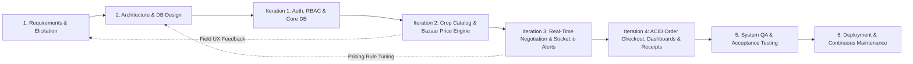
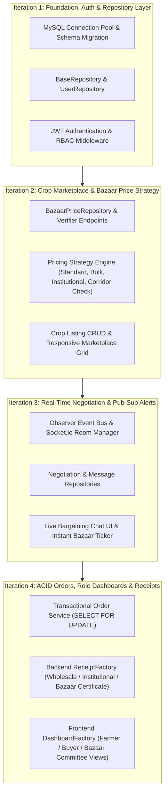

# Software Development Life Cycle (SDLC) Plan — Khamari

> **Project**: Khamari — Direct-to-Buyer Agricultural Marketplace & Bazaar Price Verification Platform  
> **Target Platforms**: Cross-Platform Responsive Web Application (PC & Mobile Browsers)  
> **Tech Stack**: React.js (Vite, Tailwind CSS) | Node.js & Express.js (ES Modules) | MySQL (`mysql2/promise`) | Socket.io  

---

## 1. Executive Summary & Selected SDLC Model

**Khamari** adopts the **Agile / Iterative and Incremental SDLC Model** (structured around 2-week Scrum-inspired iterations with continuous stakeholder feedback).

Khamari connects four distinct user groups in the agricultural supply chain:
1. **Local Farmers (`FARMER`)**: List harvest batches, track regional market prices, negotiate wholesale deals, and fulfill orders.
2. **Wholesale Buyers (`BUYER`)**: Browse verified crop batches, propose bulk bids, chat directly with farmers, and place orders.
3. **Institutional Kitchens (`INSTITUTION`)**: Procure recurring high-volume agricultural supplies with tiered bulk discounts and tax-compliant digital receipts.
4. **Local Bazaar Committees (`BAZAAR_COMMITTEE`)**: Publish and verify daily regional crop price bands (minimum, modal, and maximum wholesale rates) to prevent middleman exploitation and price manipulation.

Because user workflows span low-bandwidth mobile interfaces in rural farming areas to multi-panel desktop dashboards for institutional procurement officers and market regulators, an **Iterative & Incremental Agile approach** enables early delivery of a working core and continuous refinement of pricing rules, negotiation UX, and real-time notifications.

---

## 2. Comparative Justification: Why Agile/Iterative Beats Waterfall and Spiral

### 2.1 Comparison Matrix

| Evaluation Dimension | **Agile / Iterative (Selected)** | **Waterfall Model** | **Spiral Model** |
| :--- | :--- | :--- | :--- |
| **Requirement Flexibility** | **High** — Accommodates evolving wholesale pricing tiers, regional measurement units (`kg`, `maund`, `ton`), and negotiation rules across sprints. | **Rigid** — Freezes all requirements in Phase 1; discovering UX friction during final UAT requires costly rework. | **Moderate** — Supports iterative prototypes, but loops are gated by formal risk reviews. |
| **Mobile vs. PC UX Validation** | **Continuous** — Farmers test mobile-first crop posting in Iteration 2 while institutional buyers test desktop tables in Iteration 4. | **Delayed** — End-users only interact with the responsive UI after full backend and frontend completion. | **Prototype-Heavy** — Focuses on throwaway prototypes rather than production-ready incremental releases. |
| **Real-Time & Domain Complexity** | **Incremental Integration** — Builds REST CRUD first, then layers Socket.io negotiation rooms and Pub-Sub price alerts in Iteration 3. | **Big-Bang Integration** — Integrating MySQL transactions, Socket.io events, and React state at the end increases integration failure risk. | **Over-Engineered** — Treats standard web socket and CRUD engineering as existential R&D risks. |
| **Management & Documentation Overhead** | **Lean & Actionable** — Living engineering docs (`SDLC_PLAN`, `DATABASE_DESIGN`, `DESIGN_PATTERNS`) paired with working sprint increments. | **Heavyweight Upfront** — Months spent writing exhaustive specs before a single SQL table or API route is tested. | **Excessive Ceremony** — Every quadrant requires formal risk matrices and actuarial analysis suited for aerospace/defense projects. |
| **Time-to-First-Playable Slice** | **2–4 Weeks** — Core authentication, Bazaar price board, and crop listings are usable by end of Iteration 2. | **End of Project** — Zero deployable software until the final phase. | **Slow** — Early cycles produce risk documents and mockups rather than production features. |

### 2.2 Why Waterfall Fails for Khamari
1. **Evolving Domain Rules**: Wholesale agricultural trade involves nuanced edge cases—such as partial harvest availability, dynamic bulk discount thresholds, and Bazaar Committee price caps that fluctuate daily. Waterfall assumes all pricing formulas and negotiation states can be frozen before coding begins.
2. **Late Discovery of Accessibility Issues**: Rural farmers rely on mid-range smartphones with touch-friendly controls and clear status badges, whereas institutional buyers use dense desktop views. Discovering usability gaps during a single post-implementation testing phase leaves no time for structural UI redesign.
3. **Late Integration of Real-Time Channels**: Combining synchronous MySQL ACID transactions (for inventory locking) with asynchronous WebSocket rooms (for live price bargaining) requires iterative testing under realistic concurrency.

### 2.3 Why Spiral Is Suboptimal for Khamari
1. **Disproportionate Risk-Analysis Overhead**: Spiral's four-quadrant cycle (*Determine Objectives → Identify & Resolve Risks → Develop & Test → Plan Next Iteration*) is designed for high-budget, safety-critical systems with unproven technology. Khamari uses a proven, industry-standard stack (React, Express, MySQL, Socket.io).
2. **Resource Allocation**: Spending 25% of every cycle on formal risk modeling diverts engineering velocity away from delivering tangible marketplace features (e.g., Strategy-based bulk pricing, Factory-generated digital receipts, and live Bazaar price tickers).

---

## 3. Complete SDLC Phases & Concrete Project Deliverables

### Phase 1: Requirement Analysis & Stakeholder Elicitation
**Objective**: Define functional boundaries, user roles, regional pricing rules, and non-functional constraints (ACID consistency, real-time latency, mobile responsiveness).

- **Activities**:
  - Identify user personas (`FARMER`, `BUYER`, `INSTITUTION`, `BAZAAR_COMMITTEE`, `ADMIN`).
  - Define pricing governance rules: how Local Bazaar Committees publish daily `min_price`, `modal_price`, and `max_price` per crop and region, and how the system flags out-of-corridor listings.
  - Specify negotiation state transitions (`OPEN` → `COUNTERED` → `ACCEPTED` / `REJECTED` / `EXPIRED` → `CONVERTED_TO_ORDER`).
- **Concrete Deliverables**:
  1. **Role & Permission Matrix (RBAC Specification)**: Defining exact API and UI access levels for all user types.
  2. **User Story Backlog & Acceptance Criteria**:
     - *US-01*: As a **Bazaar Committee Verifier**, I can publish verified daily wholesale price corridors for a crop in my bazaar region so farmers and buyers have an authoritative benchmark.
     - *US-02*: As a **Farmer**, I can list a harvest batch with available quantity, base unit price, and bulk discount tiers, validated against the active Bazaar price corridor.
     - *US-03*: As a **Wholesale/Institutional Buyer**, I can open a real-time negotiation room with a farmer, propose a bulk quantity and unit price, and exchange live chat messages and counter-offers.
     - *US-04*: As a **Buyer or Farmer**, when a negotiation is accepted, the system atomically locks and deducts crop inventory, creates a confirmed order, and generates a verifiable digital receipt.
  3. **Non-Functional Requirements (NFR) Baseline**:
     - Zero overselling via MySQL `InnoDB` row-level locking (`SELECT ... FOR UPDATE`).
     - Sub-200ms Socket.io broadcast delivery for negotiation messages and Bazaar price alerts.
     - Mobile-first responsive breakpoints (`360px` mobile up to `1440px+` desktop).

---

### Phase 2: System & Database Architecture Design
**Objective**: Translate business requirements into a normalized relational database schema, modular backend/frontend architecture, and explicit software design patterns.

- **Activities**:
  - Design the 3NF MySQL relational schema covering `Users`, `BazaarPrices`, `Crops`, `Negotiations`, `Messages`, and `Orders`.
  - Define the 4 core software design patterns (**Repository**, **Observer/Pub-Sub**, **Strategy**, and **Factory**) across `/server` and `/client`.
  - Establish RESTful API contracts and Socket.io event namespaces/payloads.
- **Concrete Deliverables**:
  1. **`docs/DATABASE_DESIGN.md`**: Normalized ER diagram, SQL vs. NoSQL analysis, and complete MySQL DDL statements with foreign keys and composite indexes.
  2. **`docs/DESIGN_PATTERNS.md`**: Class diagrams, sequence flows, and ES Module code blueprints for Repository, Observer, Strategy, and Factory patterns.
  3. **API & WebSocket Contract Specification**:
     - REST endpoints (`/api/auth`, `/api/crops`, `/api/bazaar-prices`, `/api/negotiations`, `/api/orders`).
     - Socket.io events (`bazaar:price_updated`, `negotiation:join`, `negotiation:message`, `negotiation:offer_updated`, `order:created`).

---

### Phase 3: Iterative Implementation (4 Development Sprints)

#### Iteration 1: Core Infrastructure, Authentication & Repository Layer
- **Scope**: Set up the Express server, `mysql2/promise` connection pool, database initialization scripts, JWT authentication, and Role-Based Access Control (RBAC).
- **Deliverables**:
  - Working `/server` database connection pool and schema bootstrap.
  - `UserRepository` encapsulating all user queries.
  - Login/Registration flows on `/client` with role selection (`FARMER`, `BUYER`, `INSTITUTION`, `BAZAAR_COMMITTEE`).

#### Iteration 2: Crop Catalog, Bazaar Price Verification & Strategy Engine
- **Scope**: Enable Bazaar Committee members to post verified regional prices and Farmers to list crops validated and priced via the **Strategy Pattern**.
- **Deliverables**:
  - `BazaarPriceRepository` and `CropRepository`.
  - `PricingStrategyContext` with `StandardWholesaleStrategy`, `BulkTierDiscountStrategy`, `InstitutionalContractStrategy`, and `BazaarCorridorValidationStrategy`.
  - Responsive Crop Marketplace UI with regional filters, verified price badges, and dynamic bulk price calculator.

#### Iteration 3: Real-Time Bargaining Engine & Observer/Pub-Sub Notifications
- **Scope**: Build interactive buyer-farmer price negotiations and real-time broadcasts using the **Observer / Pub-Sub Pattern** and Socket.io.
- **Deliverables**:
  - `NegotiationRepository` and `MessageRepository`.
  - Domain event emitter (`MarketEventBus`) bridged to Socket.io rooms (`bazaar:<region>`, `negotiation:<id>`).
  - Split-pane PC / full-screen Mobile Negotiation Chat interface with one-click counter-offer cards and live Bazaar price change banners.

#### Iteration 4: ACID Order Checkout, Role Dashboards & Digital Receipts (Factory Pattern)
- **Scope**: Convert accepted negotiations (or direct bulk buys) into confirmed orders using MySQL ACID transactions, and render role-tailored dashboards and digital receipts via the **Factory Pattern**.
- **Deliverables**:
  - `OrderRepository` executing atomic `BEGIN` → `SELECT quantity_available FROM Crops FOR UPDATE` → inventory deduction → `Orders` insert → `Negotiations` status update → `COMMIT`.
  - Backend `ReceiptFactory` generating structured JSON/printable receipts tailored to buyer classification.
  - Frontend `DashboardFactory` rendering customized analytics and workflow panels per user role.

---

### Phase 4: Verification, Testing & Quality Assurance
**Objective**: Validate functional correctness, transactional safety under concurrent load, pricing accuracy, and responsive layout fidelity.

- **Activities & Concrete Deliverables**:
  1. **Unit Test Suite**:
     - Test each pricing strategy (`StandardWholesaleStrategy`, `BulkTierDiscountStrategy`, `InstitutionalContractStrategy`) across boundary quantities and out-of-corridor bids.
     - Test `ReceiptFactory` output schemas for each order/user type.
  2. **Database & Concurrency Integration Tests**:
     - Simulate two wholesale buyers concurrently attempting to purchase the last `500 kg` of a farmer's `800 kg` potato batch; verify that MySQL row locking allows the first transaction to succeed (`300 kg` remaining) and rejects the second with an `INSUFFICIENT_STOCK` error (`ROLLBACK`).
  3. **Real-Time Socket.io Event Verification**:
     - Verify that publishing a new `BazaarPrices` entry immediately emits `bazaar:price_updated` to all connected clients viewing that region.
  4. **Cross-Device Responsive Audit**:
     - Verify touch targets (`>= 44px`), collapsible navigation drawers, and readable typography on mobile (`375x812`) and wide desktop (`1440x900`) viewports.

---

### Phase 5: Deployment & Release Readiness
**Objective**: Package the application for reproducible local execution and cloud deployment.

- **Concrete Deliverables**:
  1. **Environment Templates**: `.env.example` files for both `/server` (DB credentials, JWT secret, CORS origin, port) and `/client` (`VITE_API_URL`, `VITE_SOCKET_URL`).
  2. **Database Migration & Seed Utility**: Automated SQL schema runner (`schema.sql`) and realistic seed script (`seed.sql`) pre-populated with regional Bazaar Committee prices (e.g., Bogura, Karwan Bazar, Sylhet), farmer harvest batches, active negotiations, and historical orders.
  3. **Production Build Pipeline**: Vite static bundle configuration and Node.js process startup scripts.

---

### Phase 6: Maintenance & Continuous Evolution
**Objective**: Support post-launch operational reliability and iterative feature expansion.

- **Concrete Deliverables**:
  1. **Historical Price Audit Archiving**: Periodic aggregation of `BazaarPrices` and completed `Orders` to track seasonal agricultural inflation and regional supply trends.
  2. **Extensibility Hooks**: Adding new payment/escrow gateways or logistics providers by extending existing Strategy and Factory interfaces without modifying core controller logic (Open/Closed Principle).

---

## 4. Risk Management & Mitigation Matrix

| Risk ID | Risk Description | Likelihood | Impact | Mitigation Strategy in Our SDLC |
| :--- | :--- | :---: | :---: | :--- |
| **R-01** | **Race Conditions / Double-Selling Crop Stock**: Two buyers accept or checkout against the same harvest batch simultaneously. | Medium | Critical | Handled in Iteration 4 via MySQL InnoDB transactions (`SELECT ... FOR UPDATE`) inside `OrderRepository.createOrderAtomic()`. |
| **R-02** | **Predatory Pricing / Unfair Bids**: Buyers submit lowball bids far below market cost, or sellers inflate prices artificially. | High | High | Mitigated in Iteration 2 via `BazaarCorridorValidationStrategy`, which validates asks and bids against the Local Bazaar Committee's verified `min_price` and `max_price`. |
| **R-03** | **WebSocket Disconnection on Unstable Mobile Networks**: Rural farmers lose connectivity mid-negotiation. | High | Medium | All negotiation offers and chat messages are persisted to MySQL (`Negotiations`, `Messages`) *before* Socket.io broadcast; reconnecting clients fetch full state via REST fallback. |
| **R-04** | **UI Clutter Across 4 Distinct User Roles**: Cramming farmer, buyer, institutional, and regulator tools into one screen. | Medium | High | Mitigated in Iteration 4 via the frontend `DashboardFactory`, which mounts clean, role-specific views and actions. |
